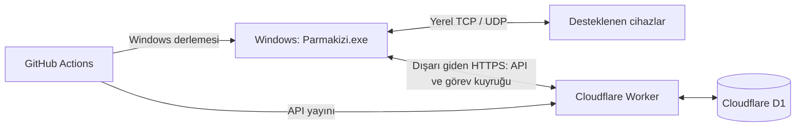

# Parmakizi

Windows masaüstü uygulaması ile yerel ağdaki PDKS / parmak izi terminallerini yönetmek için başlangıç sürümü. Sunucu ve veritabanı Cloudflare Workers + D1 üzerinde çalışır. Windows uygulaması hem yönetim arayüzü hem LAN bağlantısıdır; tarayıcı açmaz, gelen bağlantı için port yönlendirme veya VPN gerektirmez.



EXE, D1'e Worker API üzerinden erişir. Cloudflare hesap anahtarı EXE'ye gömülmez. Program kapalıyken o bilgisayarın yerel cihaz bağlantısı durur; kaydedilmiş bulut verileri D1'de kalır. Aynı sistemde birden fazla Windows bilgisayarı ve farklı yerel ağlar bulunabilir.

## Bu sürümde çalışan akışlar

- Yönetici girişi, süreli oturum ve Windows bilgisayarının bulutla eşleştirilmesi.
- Seçili özel IPv4 alt ağında /24–/30 ile sınırlı TCP portu keşfi. Sonuçlar **cihaz adayıdır**; açık port, marka veya biyometrik cihaz doğrulaması değildir. UDP cihazlarını bulmak için IP ile ekleme kullanılabilir.
- IP, port ve protokolle cihaz ekleme; bağlantı noktası seçimi.
- Kayıtlı cihazı düzenleme ve bulut kayıtlarıyla birlikte kaldırma. Bekleyen/çalışan işlem varken bu değişiklikler engellenir; fiziksel cihazın belleği silinmez.
- ZK TCP/UDP protokolü için `pyzk` adaptörü: cihaz bilgisi, personel okuma, geçiş kayıtlarını okuma, personel adı/sicili/kartını yazma ve cihazdan yeniden okuyarak doğrulama.
- Mevcut personelin cihaz yetkisi, cihaz parolası ve grubu yazma sırasında korunur. Yeni personel normal kullanıcı olarak açılır.
- Büyük kayıt listelerinin 40'lık paketlerle D1'e aktarılması (ücretsiz planın istek başına D1 sorgu sınırını gözetir), tekrarları engelleme, sayfalama, işlem ve denetim kayıtları.
- Buluttaki personel/geçiş kayıtlarının tüm sayfalarıyla UTF-8 CSV dışa aktarımı. Elektronik tablo formülleri etkisizleştirilir; başarısız aktarım mevcut dosyayı bozmaz.
- Açıkça seçilen simülatörle donanım gerektirmeyen uçtan uca test. Bağlantı hatası hiçbir zaman otomatik olarak simülatöre düşmez.
- Windows anahtarları ve iletişim şifreleri Windows DPAPI ile kullanıcıya bağlı korunur. Yönetici parolası diske kaydedilmez.
- GitHub Actions üzerinde Windows x64 EXE ve SHA-256 dosyası üretimi, kontroller ve Cloudflare yayın akışı.

## Cihaz desteğinin sınırı

“Tüm markalar” için tek bir evrensel protokol yoktur. İletişim şifresi veya üreticinin SDK lisansı programın yetkisini belirler. EXE, cihazın mevcut kimlik doğrulamasını aşmaz. Uyumluluk kataloğu `shared/catalog.ts` içindedir ve uygulamada da görünür.

İncelenen [pyzk kaynak dokümanı](https://github.com/fananimi/pyzk#compatible-devices), U580, T4-C, iClock260, iFace402/ID, MA300, iFace800/ID, K20, VF680, RSP10k1, K14, iFace702, F18/ID ve K40/ID gibi modellerin belirli firmware sürümlerini listeler. Aynı listede çalışmayan iClock260 firmware'i de vardır. Bunlar kütüphane yazarlarının bildirimleridir; bu projede fiziksel cihaz testi yapılmamıştır.

Perkotek için model/OEM protokolü bulunmadan ZK desteği varsayılmaz. Suprema, Hikvision ve Anviz katalog araştırma girdileridir; adaptörleri henüz yoktur. Bazı üretici siteleri geliştirme ortamının ağ politikası nedeniyle okunamadı; bu durum katalogda belirtilir. Otomatik marka tanıma uygulanmadı.

Biyometrik parmak izi/yüz şablonlarının aktarımı, uzaktan kayıt başlatma, kapı açma, cihaz sıfırlama, silme, ADMS push sunucusu ve diğer üretici SDK'ları bu sürümde uygulanmadı. Şu anda tek yönetici hesabı vardır; çok kullanıcılı roller henüz yoktur. Personel okuma son görülen kayıtları günceller; cihazdan silinmiş kişileri buluttan otomatik silmez. Geçişler eşsiz cihaz/sicil/zaman/durum/geçiş birleşimine göre tutulur. Aynı saniyedeki tamamen aynı cihaz kayıtları tek olay olarak değerlendirilir.

## Yerel geliştirme

Gerekenler: Node.js 22+ (CI: 24), Python 3.12, masaüstü için Tkinter. Windows Python dağıtımında Tkinter bulunur.

```sh
npm ci
python -m venv .venv
# Windows:
.venv\Scripts\python -m pip install -r gateway/requirements.txt
# Linux:
.venv/bin/python -m pip install -r gateway/requirements.txt

npm run configure:local
npm run db:local
npm run dev
```

`configure:local` en az 12 karakterlik parolayı etkileşimli ister ve yok sayılan `.dev.vars` dosyasını oluşturur. Var olan ayarları korur. `--generate` yalnızca otomatik yerel doğrulama için rastgele parola üretir; parolayı loga yazmaz. Bu seçenekle üretilen parolayı yerel testler dosyadan okur.

Başka terminalde, aynı proje dizininden:

```sh
# Windows
.venv\Scripts\python -m gateway.desktop --allow-insecure-local
# Linux (görsel oturum gerekir)
.venv/bin/python -m gateway.desktop --allow-insecure-local
```

Yerel API adresi `http://127.0.0.1:8787`'dir. HTTP geliştirme istisnası yalnızca açık CLI seçeneği ile loopback adreslerinde kullanılabilir; normal EXE HTTPS gerektirir. Windows dışındaki geliştirme çalıştırmalarında kimlik bilgileri düz metin olarak saklanmaz; yeniden girişte yeni eşleştirme gerekebilir.

Bulut geliştirme makinesinde ev dizini yazılamıyorsa `XDG_CONFIG_HOME=/tmp/parmakizi-config` ve `npm --cache /tmp/parmakizi-npm-cache` kullanın. Her bulut görevi zaten yalıtılmıştır; kullanıcı özellikle istemedikçe yeni Git worktree oluşturmayın.

## Cloudflare kurulumu

1. Cloudflare hesabında Workers ve D1 erişimini hazırlayın. Kendi bilgisayarınızda `npx wrangler login` çalıştırın veya GitHub Actions için sınırlı bir API token tanımlayın.
2. `npx wrangler d1 create parmakizi` çalıştırın. Dönen D1 `database_id` değerini `wrangler.jsonc` içindeki sıfırlarla dolu yer tutucuya yazın. Bu kimlik gizli değildir; hesaba özeldir. `database_name` ve binding `DB` korunmalıdır.
3. Worker'ın gizli değişkenlerini güvenli istemler üzerinden ekleyin:

   ```sh
   npx wrangler secret put ADMIN_PASSWORD
   npx wrangler secret put SESSION_SECRET
   ```

   `ADMIN_PASSWORD` en az 12 karakter; `SESSION_SECRET` rastgele ve en az 32 karakter olmalı. Aynı oturum anahtarını başka ortamlarda paylaşmayın. Parolayı veya Cloudflare token'ını kaynak koduna, GitHub değişkenlerine ya da sohbet mesajına koymayın.
4. `npm run db:remote` ve `npm run deploy` çalıştırın. Worker adresini EXE'nin giriş ekranına girin. `/api/health` D1 şemasına erişimi de kontrol eder; cihaz bağlantısını doğrulamaz.
5. GitHub'da `production` environment içine **secret** olarak `CLOUDFLARE_API_TOKEN`, `ADMIN_PASSWORD` ve `SESSION_SECRET`; repository variable olarak `CLOUDFLARE_ACCOUNT_ID` tanımlayın. API token yalnızca ilgili hesapta Workers Scripts düzenleme ve D1 düzenleme yetkilerini içermeli. Parola ve oturum anahtarı 3. adımdaki uzunluk şartlarını sağlamalı.
6. Repository variable `CLOUD_API_URL` değerini yayınlanan HTTPS Worker adresi yapın. Windows derlemesi bunu yalnızca varsayılan sunucu adresi olarak gömer; kullanıcı girişte değiştirebilir.
7. Otomatik ana dal yayını için repository variable `ENABLE_CLOUDFLARE_DEPLOY=true` yapın. Alternatif olarak `Deploy Cloudflare` workflow'unu elle çalıştırın. Başlangıçta otomatik dağıtım kapalıdır. Üretim workflow'u D1 kimliği yer tutucuysa hesabınızdaki `parmakizi` veritabanını bulur veya oluşturur; şemayı, API'yi ve çalışma zamanı gizli değişkenlerini yayımlar. Dolayısıyla GitHub yolunda 2–4. adımların elle yapılması gerekmez. Oluşturulan D1 kimliği çalışma sırasında bağlanır; her yeni yayında aynı isimdeki mevcut veritabanı kullanılır. Yerelde aynı hazırlık için `python scripts/prepare_cloud.py` kullanılabilir.

Bu kurulumda `parmakizi` D1 veritabanı ve `https://parmakizi.mobilyaoztemur.workers.dev` API'si Cloudflare üzerinde oluşturulmuştur. Masaüstü uygulamasında varsayılan API adresi hazır gelir. İlk yayın canlı simülatör akışıyla doğrulanmıştır; son sürümün doğrulama sonucu dağıtım sırasında kontrol edilmelidir. Donanım uyumluluğu ayrıca sahada doğrulanır.

## Windows EXE alma ve kullanma

`Windows EXE` workflow'u `main` üzerindeki masaüstü değişikliklerinde, `v*` etiketlerinde veya elle çalıştırıldığında Windows runner üzerinde Python ve Tkinter dahil bağımsız `Parmakizi.exe` üretir. Actions çalıştırmasının **Artifacts → Parmakizi-Windows-x64** paketini indirin. EXE dijital olarak imzalanmamıştır; yayımlama için kod imzalama sertifikası ayrıca gerekir. SHA-256 dosyası aynı pakettedir.

Derlenen EXE, paketlenmiş haliyle Windows runner üzerinde ayrıca başlatılır. Pencere kurulumu, içindeki varsayılan adresle canlı HTTPS API bağlantısı, kimliksiz erişimin reddi ve DPAPI şifreleme/çözme kontrol edilir. Gizli değer içermeyen sonuç `self-test.json` olarak pakete eklenir. Bu kontrol fiziksel cihaz uyumluluğunu doğrulamaz.

ZK adaptörünün `pyzk` bağımlılığı GPLv2 lisanslıdır. İlk paket proje içi kullanım içindir; dış dağıtımdan önce uygulama lisansını veya uygun lisanslı üretici SDK alternatifini belirleyin. Kaynak ve üçüncü taraf bildirimleri pakete eklenir; ayrıntılar `THIRD_PARTY_NOTICES.md` içindedir.

1. EXE'yi açın; Cloudflare HTTPS adresi, yönetici parolası ve izinli alt ağı girin. Algılanan alt ağ önerisini kontrol edin. Birden fazla alt ağ virgülle ayrılır. VPN veya farklı adaptörler varsa yalnızca cihazların bağlı olduğu alt ağları seçin.
2. Bilgisayar otomatik eşleştirilir. `Ağda keşfet` ile /24–/30 arasında izinli bir alt ağı tarayın. `İşlemler` sekmesindeki sonucu çift tıklayarak aday IP'leri görün.
3. `Cihaz ekle` ile IP/port ve doğru protokolü kaydedin. `İletişim ayarı` ile yerel ZK iletişim şifresini, gerektiğinde zorunlu UDP ve karakter kodlamasını ayarlayın. Cihaz şifresi buluta gönderilmez.
4. `Cihaz bilgisi` ile gerçek bağlantıyı deneyin; sonra `Personel oku` veya `Geçişleri oku` kullanın. İlgili sekmede `Seçili cihazın bulut kayıtlarını yükle` ile D1 kayıtlarını görüntüleyin. İkinci bilgisayara bağlı cihazın işlemini o bilgisayar yürütür.
5. `Personel yaz` mevcut aynı UID'yi güncelleyebilir; uygulama önce onay ister ve cihazdan geri okuma yapar. Sonucu `İşlemler` sekmesinde kontrol edin, bulut görünümünü yenilemek için yeniden `Personel oku` çalıştırın.
6. Personel ve geçiş sekmelerindeki `Tüm kayıtları CSV kaydet`, seçilen cihazın buluttaki tüm sayfalarını dışa aktarır. Cihazlar sekmesinin altındaki düzenleme/kaldırma düğmeleri bulut kaydını yönetir. Cihaz kaldırma onayı, o cihazın bulut verilerini de siler; terminalin kendisindeki kayıtlar korunur.

Yerel korumalı ayarlar `%LOCALAPPDATA%\Parmakizi\config.json` altındadır. DPAPI çözümü aynı Windows kullanıcısını gerektirir. Bağlantı noktasının anahtarı buluttan iptal edilebilir. EXE'nin dışarı doğru HTTPS ve yerel cihaz portlarına erişebilmesi gerekir. Cihaz portlarını internete açmayın.

## Kontroller

```sh
npm run build                    # TypeScript + Worker paketlemesi (dry run)
npm test                         # ağ sınırı, SDK davranışı, anahtar koruması
python scripts/wait_api.py       # npm run dev çalışırken
npm run test:integration          # gerçek yerel Worker + D1 + simülatör
python -m unittest discover -s tests_desktop -v
```

Canlı yayın sonrası doğrulama: `python -m scripts.smoke_live`. Ortamdan `ADMIN_PASSWORD`, `CLOUDFLARE_API_TOKEN`, `CLOUDFLARE_ACCOUNT_ID` alır; geliştirme parolasını kullanmaz. Geçici bir simülatör bağlantı noktasıyla giriş, cihaz düzenleme/kaldırma, personel aktarımı, geçiş aktarımı ve anahtar iptalini kontrol eder. Sonunda yalnızca kendi oluşturduğu test kayıtlarını temizler; fiziksel cihaza bağlanmaz.

Linux'ta masaüstü testinin bir X oturumu gerekir; CI `xvfb-run` kullanır. Windows DPAPI testi Linux'ta açıkça atlanır ve Windows workflow'unda çalışır. Donanım testi için ilgili cihazın IP, firmware, iletişim şifresi ve fiziksel erişimi gerekir.

## İşlem güvenceleri ve işletim sınırları

Her bağlantı noktasında aynı anda tek görev sahiplenilir. Görev sahiplenme ve istemci istek kimlikleri tekrar yazmayı engeller. Görev sonucu gelmezse 10 dakikalık süre sonunda yazma işlemi `uncertain` olur; otomatik tekrar gönderilmez. Cihazdan okuyup sonucu kontrol edin. Okuma paketleri tamamlanmadan aktarılan kayıtlar bulutta görünebilir; aktarımın tamamlandığını görev durumu gösterir. Geçiş zamanları cihazın yerel zamanı ve `Europe/Istanbul` saat dilimiyle UTC'ye dönüştürülür; diğer bölgeler için CLI bağlantı yapılandırması değiştirilmeli. Mevcut Windows arayüzü Türkiye saat dilimini kullanır.

Bu ilk sürüm, tam erişim kontrol yazılımı sertifikasyonu veya bütün cihazlarla saha uyumluluğu iddiası taşımaz. D1 yedekleme, veri saklama süresi, çok kullanıcılı roller, şifre döndürme ekranı, otomatik EXE güncellemesi ve imzalı dağıtım üretim ihtiyaçlarına göre tamamlanmalıdır.
